# Glydaway home screen redesign

The home screen is now an airport at night, with its own look and layout. Gameplay is unchanged: the run itself (physics, hazards, scoring, speed) is untouched.

## What changed

| | Before | After |
|---|---|---|
| **Background** | A bot playing a live run behind the menu (hazards, coins and power-ups scrolling under the buttons) | A calm airport at night: twinkling stars, the moon, the control tower and terminal, a runway with lights. No hazards, coins or power-ups behind the menu. |
| **How-to chips** | Six chips: TAP jump, HOLD glide, 2× TAP flip gravity, MAGNET, SHIELD, BOOST | Gone from the home screen. Taught in a short interactive tutorial the first time you press PLAY, and again from **Settings → How to play** |
| **Keyboard hint** | Always shown (and on touch phones, where it doesn't apply) | Only on devices with a keyboard (a mouse or trackpad, or once a key has been pressed). Never on touch-only phones. |
| **"Turn your phone sideways"** | Always shown in portrait | Shown once, on the very first launch, then never again |
| **Stats** | "BEST 1234 m · 87 coins" under PLAY | Top bar: coins on the left (most coins in one run, the coin stat the game keeps), best distance on the right |
| **Title** | Large, pulsing quickly | A little smaller, with a slow shimmering glow |
| **Departures board** | — | A split-flap board under the title. It flips between **NEXT FLIGHT: PARIS** (every trip leaves the airport for Paris first), **CITIES REACHED: n OF 13** and **NEXT NEW CITY: …** (the first city on the route you haven't reached yet). The city count comes from what the game already tracks: each city unlocks its skin the first time a run reaches it. |
| **Hero** | Small, part of the attract run | Your selected hero, about 3× its in-game size, hovering over the runway with flapping wings. Tap it to open the Locker Room. |
| **PLAY** | — | One big PLAY button that pulses gently |
| **Buttons** | Three text buttons that wrapped onto two or three rows, sitting on top of scene sprites (the Settings button over a coin/diamond, spikes behind Locker Room) | One row of three equal buttons with pixel icons (trophy, shirt, gear). They always sit on the tarmac **below** the runway line, so they never cover the hero, a plane or any scene sprite. |
| **Credit line** | Overlapped the buttons on short screens | At the very bottom, small and readable. The text is exactly: Gleyde Technologies, LLC · Created by Sam Eyde III · Produced by Juwon Shon |
| **Landscape** | The same column squeezed in: the title cut off at the top, dark bars top and bottom, buttons overlapping | Its own two-column layout that fills the screen: title, board and hero on the left; PLAY and the three buttons on the right. Respects the notch and Dynamic Island safe areas. |
| **Motion** | — | <ul><li>A plane takes off down the runway every 10–15 s.</li><li>The runway lights blink in a chase.</li><li>The windsock swings in the wind.</li><li>The stars twinkle.</li><li>Pressing PLAY sends the hero down the runway into the run: the world speeds up to run speed and the run carries straight on, with no hard cut.</li></ul> |

## Screenshots

These are Safari-sized viewports in WebKit (the iPhone/iPad engine). The test suite also checks every device as a home-screen app at full screen size, with notch, Dynamic Island and home-bar safe areas.

### iPhone SE (375 × 667)
| Before | After |
|---|---|
| 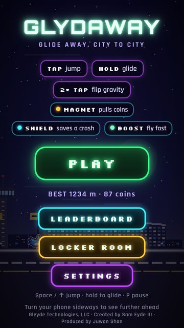 | 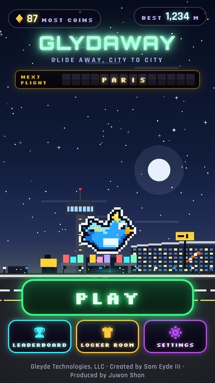 |
| 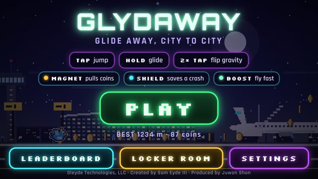 | 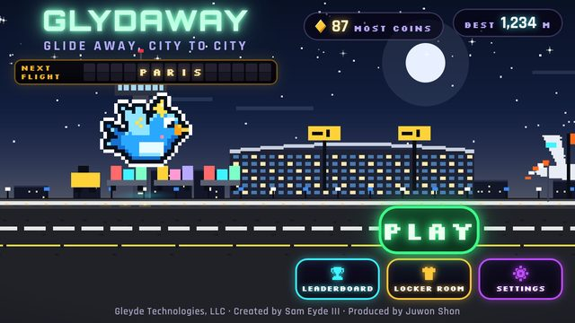 |

### iPhone 15 (393 × 659)
| Before | After |
|---|---|
| 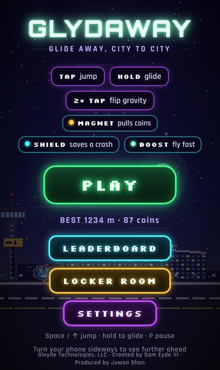 | 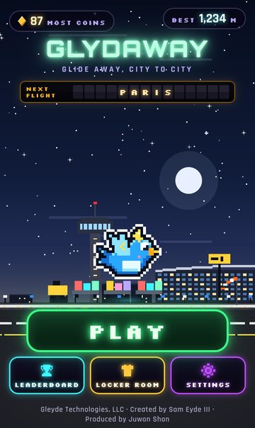 |
| 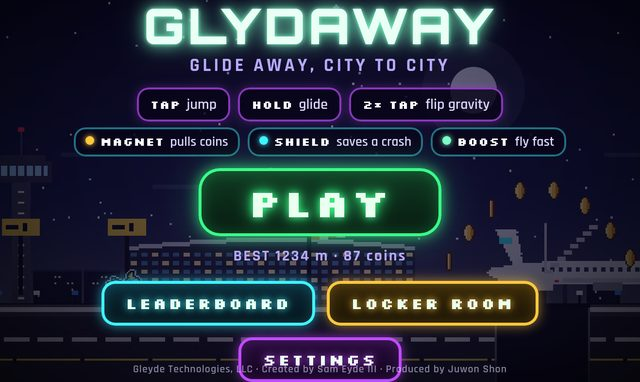 | 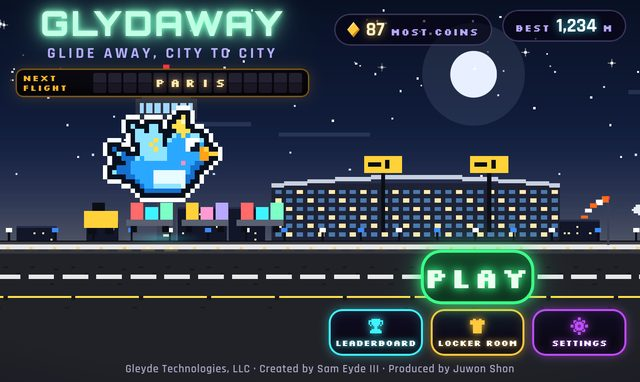 |

### iPhone 17 Pro Max (440 × 763)
| Before | After |
|---|---|
| 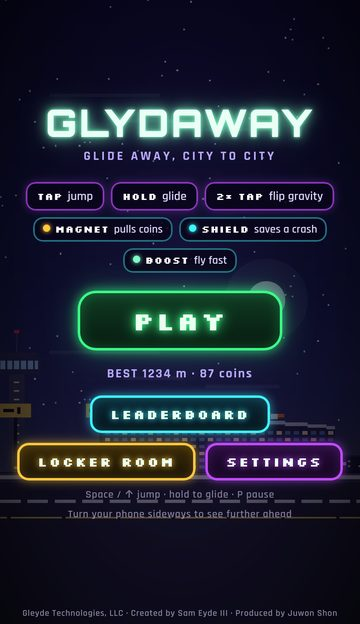 | 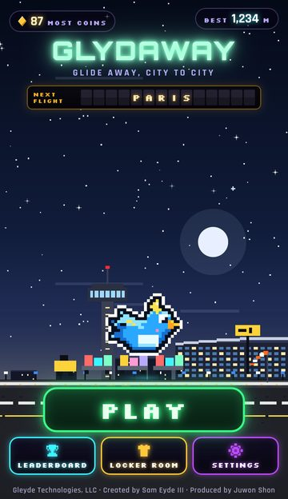 |
| 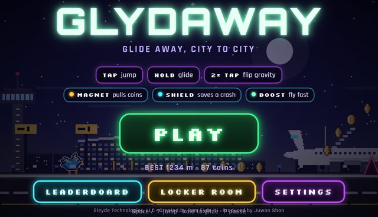 | 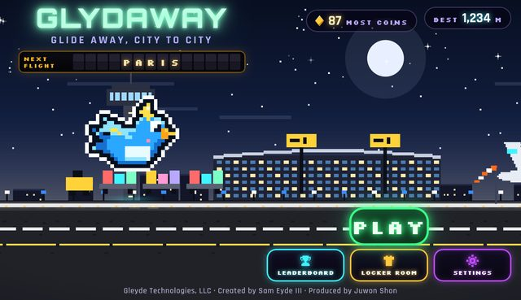 |

### iPad (656 × 944)
| Before | After |
|---|---|
| 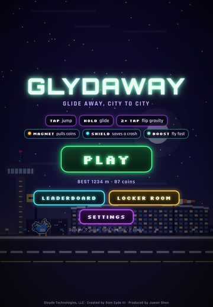 | 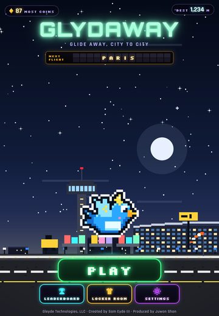 |
| 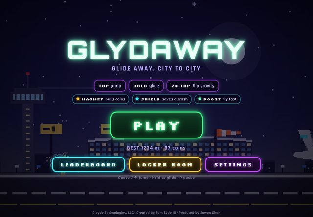 | 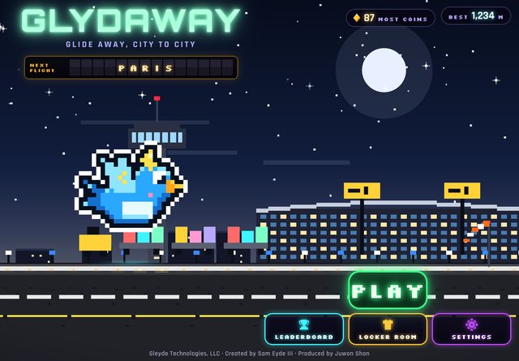 |

### Life and motion
| A plane taking off (behind the hero) | The board flipping to cities reached | PLAY: the hero dashes into the run | The run starts |
|---|---|---|---|
| 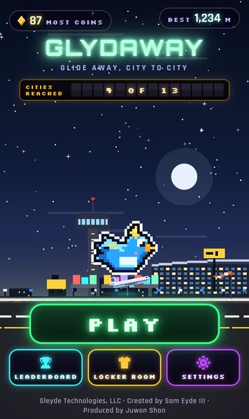 |  | 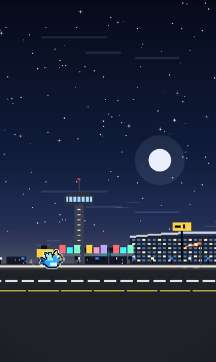 | 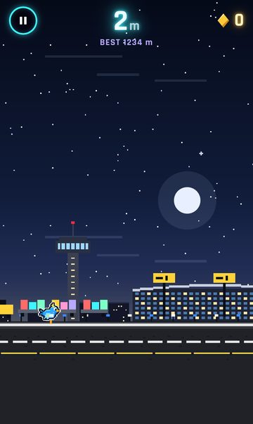 |

### Tutorial and Settings
| First PLAY: tap to jump | Hold to glide | Settings → How to play |
|---|---|---|
| 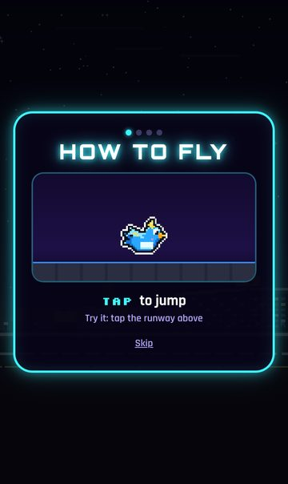 | 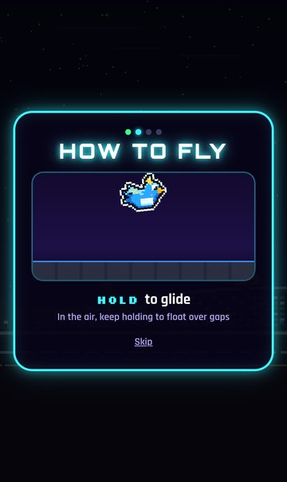 | 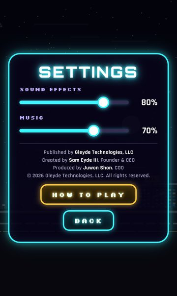 |

The tutorial has four steps. Each waits for the real gesture (Space works as a tap or a hold too), then moves on:
1. Tap to jump.
2. Hold to glide.
3. Double-tap to flip gravity. This is shown under the purple roof track, because flips only work in flip zones.
4. The three power-ups.

**Skip** or **Esc** closes it at any point.

## Smooth on older phones

- **Static background drawn once:** while the home screen is up, the sky, skyline and runway are painted once and reused. Only the stars, the plane, the runway lights and the windsock are drawn each frame.
- **Cheap animation:** the hero's wings, the title glow and the PLAY pulse are compositor-only (transform and opacity).
- **No new assets:** nothing new to download (every piece is drawn in code), so there's no extra load time.
- **Pauses when hidden:** everything is driven by the game's own frame loop and CSS animations, so it all pauses when the tab is hidden.
- **Reduce Motion:** turns off the plane, the twinkle, the pulses and the takeoff animation. PLAY then starts the run right away.

Home screen frame rate on an iPhone-15-sized screen:

| | Before | After |
|---|---|---|
| Chromium, CPU slowed 4× | 39–45 fps | 60 fps |
| Chromium, CPU slowed 6× | 32–36 fps | 60 fps |
| Chromium / Firefox, normal speed | 60 fps | 60 fps |
| WebKit (headless, software rendering, so slow either way) | 20–22 fps | 23–26 fps |

## Tests

`node glydaway/tests/home.test.cjs` (227 checks; WebKit, Chromium and Firefox) and `node glydaway/tests/credits.test.mjs`.

**Layout:** iPhone SE, iPhone 15, iPhone 17 Pro Max and iPad, in portrait and landscape, as a Safari page and as a home-screen app with safe areas. Checks that:
- everything is on screen and inside the safe area
- nothing overlaps and no text is clipped
- the buttons sit below the runway line and the hero above it
- there are no hazards, coins or power-ups behind the menu
- the hero is about 3× its in-game size
- there are no how-to chips
- the credit line is exact
- in landscape, the title and hero are on the left and PLAY and the buttons on the right

**Behaviour:** checks that:
- the keyboard hint is hidden on touch devices and shown with a keyboard
- the sideways tip shows once and never again
- the first PLAY opens the tutorial, and each step needs the real gesture (by touch and with Space)
- the tutorial is remembered once finished
- Settings → How to play opens it, and Esc returns to Settings without starting a run
- tapping the hero opens the Locker Room
- the board shows the real data
- planes take off 10–15 s apart
- the takeoff hands over to the run at run speed
- the run plays as before
- Reduce Motion starts the run right away
- there are no page errors
