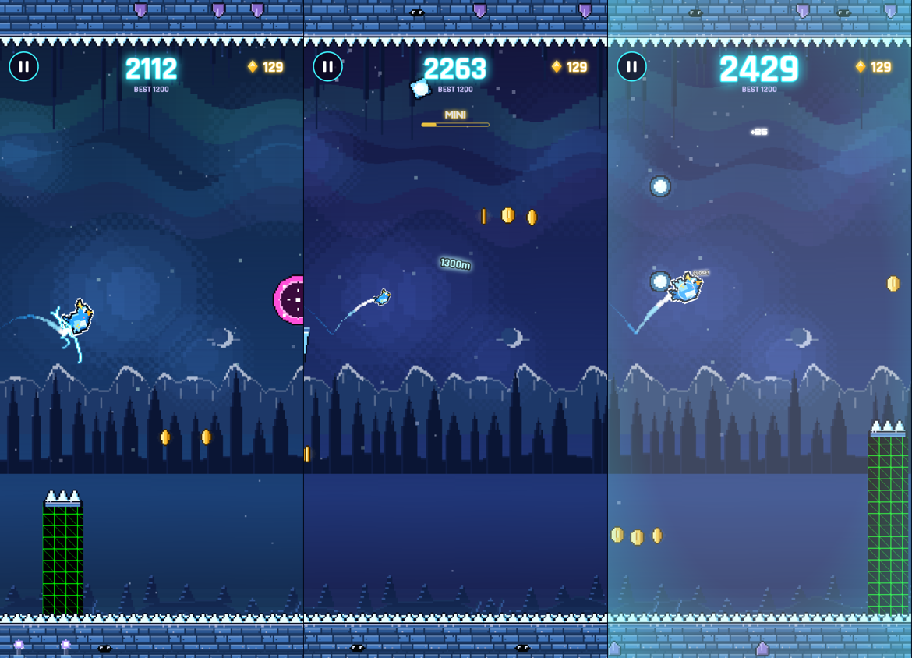
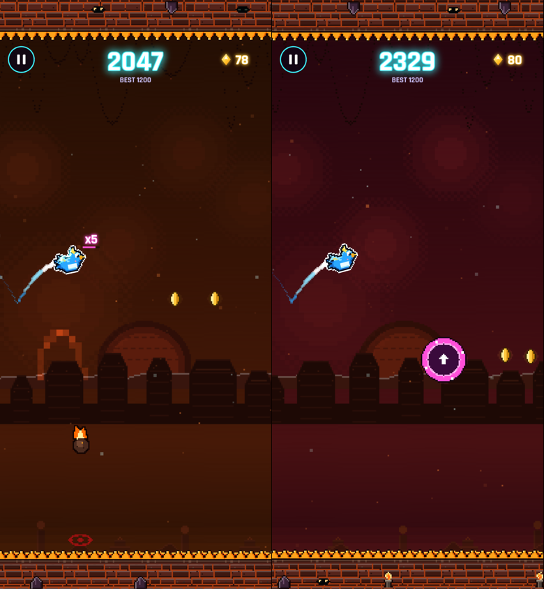
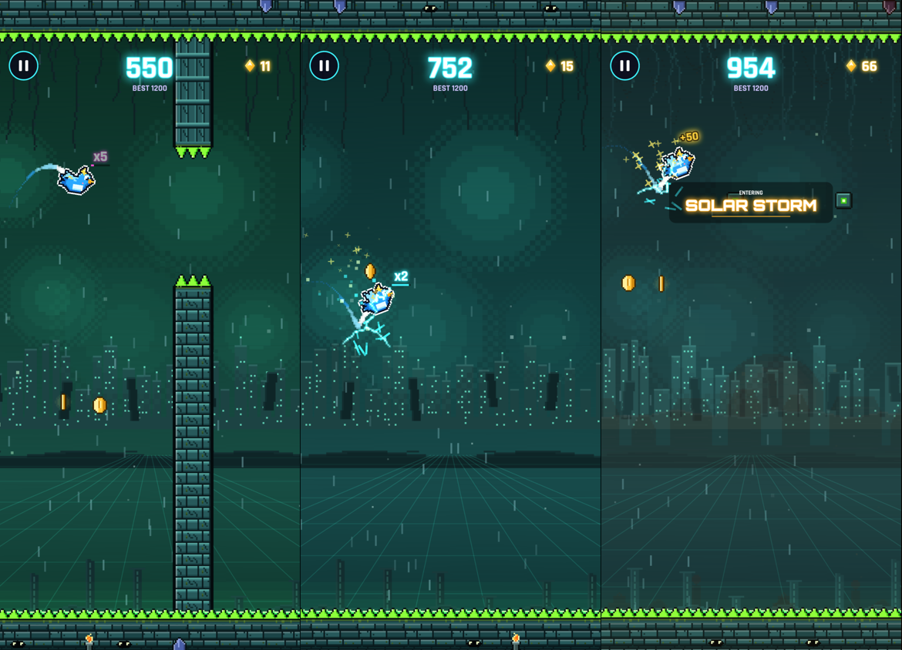
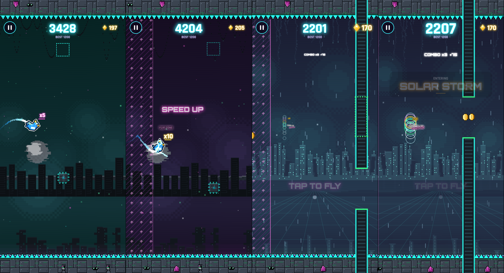
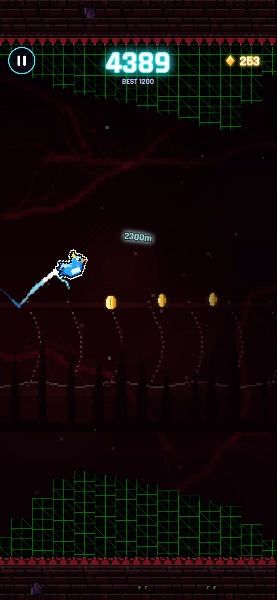

# Scenery & variety upgrade: report

Five realms were upgraded one at a time, in this order: **Frozen Nebula, Solar Storm, Neon Void, Glitch Realm, Abyss**. The Calm is unchanged.

**Not changed:** scoring, difficulty (world speed, gap sizes, spacing, the Abyss difficulty cap and its extra room), characters, menus and dimensions. The one exception: RONIN's Fire Ward also covers the new Solar Flare Arc, as it covers every Solar fire hazard.

Each realm got:
- **parallax layers:** 4 scenic layers that move at different speeds (distant, far, mid, near top + near bottom), plus a faint sky effect. The scenery is kept darker than the hazards, so hazards always read first.
- **a new signature hazard** with a clear warning before it can hurt;
- **new combination patterns**, built from hazards the player has already met in that realm;
- **never the same pattern twice in a row**, in every realm (`ObstacleManager.lastKind`);
- **performance:** new hazard art goes into the existing `hz` atlas, new hazards come from the obstacle pools and are prebuilt with the realm, and sky effects are thinned out on Low Graphics and calmed with Reduce Flashing. The fps and memory cost was measured before and after each realm (see Performance below).

## Per realm

### Frozen Nebula 
- **Scenery:**
  - icy navy sky with two aurora ribbons (one on Low Graphics; slower with Reduce Flashing);
  - distant glaciers, ice spires, frozen trees;
  - ice fangs above and snow drifts below.
- **New hazard: Frost Comet** ([picture](scenery/frozen-comet.png)). Its dashed flight path shows for 1.15 s, then the comet flies along it.
- **New patterns:** Ice Curtain, Slider Pair, Zap Stairs, Gauntlet.
- **Patterns of its own:** 3 → 8.

### Solar Storm 
- **Scenery:**
  - an ember sunrise with prominence arcs swelling off the horizon;
  - mesas and sun temples;
  - scorched spikes above and lava dunes below.
- **New hazard: Flare Arc** ([picture](scenery/solar-flare.png)). A dashed dome marks its reach for 1.1 s, then it burns for 0.9 s.
- **New patterns:** Eruption, Shower, Fire Pair, Geyser + Bar.
- **Patterns of its own:** 3 → 8.

### Neon Void 
- **Scenery:**
  - a neon skyline over a scrolling perspective floor grid;
  - monoliths and circuit ruins;
  - neon wires above and data rubble below.
- **New hazard: Neon Pulse** ([picture](scenery/void-pulse.png)). A dashed circle shows its reach for 1.0 s, then the ring grows over 0.6 s.
- **New patterns:** Slalom, Blade Duo, Laser + Blade, Pulse Pair.
- **Patterns of its own:** 3 → 8.

### Glitch Realm 
- **Scenery:**
  - a moon cut into slices, with RGB-split tear bands sliding across the sky now and then (rarer and slower with Reduce Flashing; one at a time on Low Graphics);
  - server racks and a sliced city;
  - pixel drips above and data blocks below.
- **New hazard: Corrupt Column.** A dashed green ghost shows where its opening will move for 0.9 s. The opening jumps there at least 0.75 s before the player arrives.
- **New patterns:** Blink Pair, Blink + Gate, Column Pair, Blink + Column.
- **Patterns of its own:** 2 → 7.

### Abyss 
- **Scenery:**
  - a vast ribcage rising out of the dark;
  - thorn spires;
  - the old ruins and chains;
  - a jaw of fangs above and a floor of ash and bones below;
  - dark red veins across the sky that swell with the realm's heartbeat (drawn once, so only their brightness changes; fewer veins on Low Graphics, a gentler swell with Reduce Flashing).
- **New hazard: Eye Beam** ([warning](scenery/abyss-eyebeam-warn.png), [beam](scenery/abyss-eyebeam.png)):
  - an eye opens in the ceiling or floor, and a dashed red line shows exactly how far the beam will reach for 1.1 s;
  - then a short beam fires for 0.75 s;
  - it reaches at most 40% of the screen height, so most of the way stays open.
- **New patterns:** Eye Pair, Tendril + Eye, Slammer + Eye. All three are deliberately gentle: two hazards on opposite sides, widely spaced. The Abyss keeps its difficulty cap, its extra room and its 180 m simple-obstacles-only opening.
- **Patterns of its own:** 3 → 7.

## Pattern counts

| Realm | Patterns of its own, before → after | New hazard | New combinations |
|---|---|---|---|
| Frozen Nebula | 3 → 8 | Frost Comet | 4 |
| Solar Storm | 3 → 8 | Flare Arc | 4 |
| Neon Void | 3 → 8 | Neon Pulse | 4 |
| Glitch Realm | 2 → 7 | Corrupt Column | 4 |
| Abyss | 3 → 7 | Eye Beam | 3 |

The shared saws, gates, double saws and portals still appear on top of these in every realm except the Peaceful Valley.

## Performance (before → after, same 120 m of each realm)

Measured in headless Chromium at iPhone size, with every frame rendered. The renderer is software GL, so the absolute CPU time per frame is far above a real phone's. Only compare each "after" with its own "before". The heap is the JavaScript heap at the end of the stretch; growth is how much it grew across the stretch.

| Realm | CPU ms / frame | Heap MB | Heap growth MB |
|---|---|---|---|
| Frozen Nebula | 256.8 → 262.8 (+2%) | 12.3 → 12.4 | 0.3 → 0.3 |
| Solar Storm | 232.2 → 229.9 (−1%) | 12.0 → 12.1 | 0.4 → 0.4 |
| Neon Void | 229.1 → 243.4 (+6%, the floor grid) | 11.4 → 11.6 | 0.5 → 0.6 |
| Glitch Realm | 276.4 → 272.9 (−1%) | 12.6 → 12.9 | 0.2 → 0.2 |
| Abyss | 339.3 → 338.4 (0%) | 13.1 → 13.4 | 0.3 → 0.3 |

The raw numbers are in `docs/scenery/perf-<realm>-before.json` and `-after.json`.

## Bug sweep

The sweep is a god-mode flight through every realm with a simple auto-pilot, plus the full test suite.

| Check | Result |
|---|---|
| 3 km flight (Void → Solar → Frozen → Glitch → Abyss → Valley → Hurricane) in each of three settings: normal, Low Graphics, Reduce Flashing | every realm reached; no console errors in any setting |
| A new hazard (Comet, Flare Arc, Neon Pulse, Eye Beam) touching the hero before it is live | never, in all three settings |
| A Corrupt Column opening jumping with less than 0.75 s to go | never |
| No pattern twice in a row | 0 repeats (every realm, 6 runs each, plus the Frost Comet test over 2 km) |
| 14 km flight through the dimensions | obstacle pools stop growing (84 objects at 8 km and at 14 km); at most 6 obstacles live at once; scene objects only grow as each new dimension's art is first built (541 → 560) |
| Memory over each realm (performance runs above) | 0.2–0.6 MB growth over 120 m, the same before and after |
| Full test suite (`test:all`) | passes |

Problems found and fixed during the upgrade:
- **Combination patterns never appeared:** the one-at-a-time introductions used up each realm. Combinations are now made only of hazards already met, so they need no introduction of their own, and they unlock soon after their parts.
- **Solar sun looked like a pale moon:** it is now drawn in explicit ember reds.
- **Flare Arc warning dots were too small to read:** they are now 3 px.
- **Abyss ribs read almost as bright as hazards:** their rim is now broken, so the scenery stays darker than the hazards.
- **WebKit-only flaky test** (the Neon Void CI run): after LOG OUT reloaded the page, the accounts tests didn't wait for the reload, so they could reach into the page mid-reload. They now wait for the next page load. This was a test bug; the game was fine.
- **The release-build test always used port 4318:** a second checkout could end up testing another checkout's build. The port can now be overridden with `RELEASE_URL`.

Known limitation: the Abyss is short (about 460 m, with its first 180 m kept simple), so not every pattern shows up on every lap. In 6 laps, 6 of its 7 patterns appeared; Slammer + Eye is the rarest.

## Tests

- **New:** "scenery: the Frost Comet always warns first; no pattern twice in a row". It checks:
  - the Frost Comet warns for more than 1 s and can't hurt before it flies;
  - no pattern repeats in a 2 km run.
- **New:** "scenery: the Abyss Eye Beam warns first and never closes the way". It checks, from both the ceiling and the floor:
  - the warning lasts more than 1 s;
  - the eye can't hurt before it fires;
  - at least 59% of the screen height stays open.
- `test:all` passed locally after every realm, and CI (Chromium, Firefox, WebKit) passed before every deploy.
