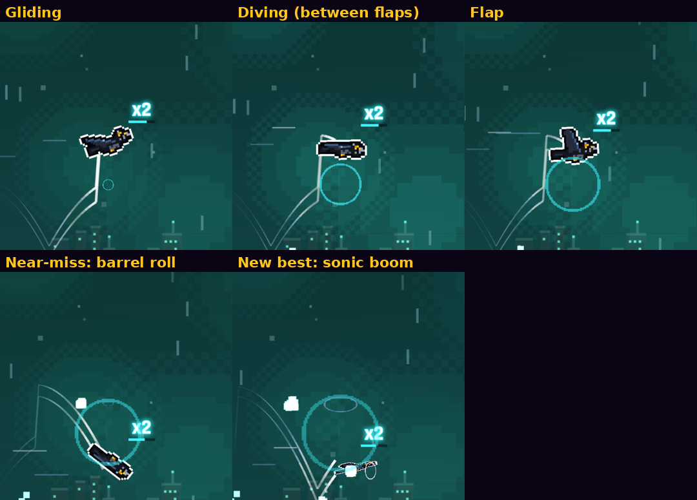
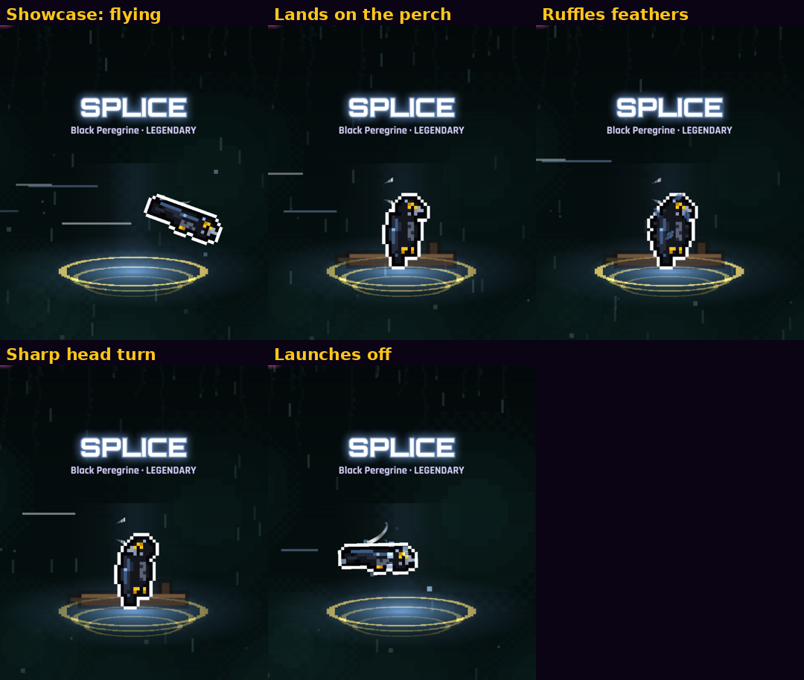
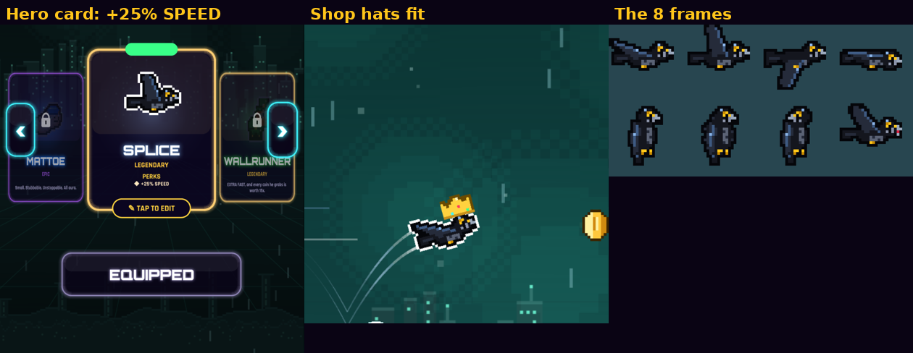

# SPLICE · Legendary · "Fastest thing in the sky."

A black peregrine falcon:
- glossy black feathers with a blue-steel sheen;
- long pointed, swept-back wings and a hooked beak;
- golden eyes with the peregrine's dark "teardrop" under each;
- yellow talons tucked up in flight.

He's original 24×24 pixel art in 8 frames, with the usual bold dark outline plus the white rim. His hitbox is standard.

- **Unlock:** 12,000 coins in the shop, or the challenge "Reach 2,000m in one run".
- **Perk:** +25% SPEED (`speed: 1.25`, the same mechanism as RONIN at 1.1 and WALLRUNNER at 1.2). It's shown on his hero card.
- **Test flag:** `?character=splice` (test builds only).

## Animation, effects, sound (`src/player/spliceFx.js`)

| | |
|---|---|
| Flap | Wings snap up, then drive down; between flaps he tucks into a dive pose, nose down a little. Sound: a sharp, fast wing whoosh. |
| Glide | After a while without a flap: wings swept back like a stooping falcon. |
| Idle (HEROES screen) | Flies, lands on a pixel branch, ruffles his feathers, snaps his head round twice, then launches off. The turntable eases out while he's perched. |
| Near-miss | A quick barrel roll (he flips over his long axis) with a burst of wind. |
| New best | A fierce synth screech ("kee-kee!", no recordings) and a sonic-boom ring as he lunges forward. Only the drawing lunges; the hitbox never moves. |
| Trail | Sharp wind streaks off both wingtips and speed lines streaming past, with a faint blue-steel shimmer. |
| Death | Black feathers burst out in a spiral and he tumbles away. Sound: a feather burst and a fading rush of wind. Equipped death effects still play. |

- **Reduce Flashing:** no shimmer, softer and slower rings.
- **Low Graphics:** fewer streaks, feathers and puffs.
- **Shop hats:** they sit on his head (anchored from the glide pose).
- **Portraits:** the leaderboard, share card and game over use his wings-up portrait.

## Leaderboard

Runs flown with a faster hero (SPLICE +25%, WALLRUNNER +20%, RONIN +10%) now show a small cyan speed badge (two chevrons) on both boards. Tapping the hero shows e.g. "SPLICE · +25% SPEED".

RONIN keeps his gold perk badge, which is now only for coin and survival perks.

## Fairness: is +25% speed unfair? (measured, for you to decide)

### 1. Score per distance is the same

With god mode on, a gap-steering pilot flew the same 6 courses to 3,000 m with each hero:

| Hero | Speed | Time to 3,000 m | Score at 3,000 m | vs VOLT |
|---|---|---|---|---|
| VOLT | 1.00 | 131.5 s | 8,084 | — |
| RONIN | 1.10 | 120.2 s | 7,335 | −9% |
| WALLRUNNER | 1.20 | 110.2 s | 6,892 | −15% |
| **SPLICE** | **1.25** | **105.5 s** | **7,855** | **−3%** |

- **Distance is the same per metre:** obstacles are placed by distance, so a faster hero meets the same obstacles per metre and earns the same metres.
- **Bonus isn't higher:** every hero hit the ×10 combo cap, and the faster heroes didn't earn more bonus. The differences are within course-to-course noise.

**So speed gives no direct score advantage.**

### 2. It makes the run harder

SPLICE meets 25% more obstacles per second. Time between obstacles, in seconds:

| Metres | VOLT | RONIN | WALLRUNNER | SPLICE |
|---|---|---|---|---|
| 0 | 1.48 | 1.34 | 1.23 | 1.18 |
| 1,000 | 0.84 | 0.77 | 0.70 | 0.67 |
| 3,000 | 0.59 | 0.54 | 0.49 | 0.47 |
| 8,000 | 0.55 | 0.50 | 0.46 | 0.44 |
| Abyss / dimensions peak | 0.49 | 0.45 | 0.41 | 0.40 |

His tightest gap (0.40 s) is within 0.01 s of WALLRUNNER, who is already live.

### 3. It stays fair

- **Gravity, flap strength, gap sizes and the hitbox are unchanged.**
- **Every signature hazard warns by time, not distance:** comet, flare, neon pulse and eye beam trigger on time-to-arrival, so their warnings last just as long in seconds for him.
- **The Abyss's hardest pattern (Slammer + Eye Beam), flown as SPLICE with real collisions:**
  - forced 16 times with no deaths;
  - the open lane was never under 142 px;
  - the eye always warned at least 1.10 s ahead.

### What this means

- **Score board:** speed is a skill handicap, not a points boost. Skilled players will also finish runs about 20% faster in real time.
- **Distance board:** same picture. Equal metres need equal obstacles passed, just at a faster pace.
- **One indirect edge:** none of the above changes, so a very skilled player who handles the pace isn't penalised either.
- **If you want it gentler** (not applied):
  - (a) cap his absolute top speed at WALLRUNNER's, so only his early game is faster;
  - (b) lower the perk to +20%;
  - (c) show speed heroes on a separate filter of the board.

## Tests

The new test is "SPLICE: +25% speed with the standard hitbox, falcon moves, speed badge, perch showcase". It checks:
- the 1.25 ratio and standard hitbox;
- the flap, downstroke and dive frames;
- the barrel roll flip, the screech frame on a new best, and the tumble then disappear on death;
- the price and unlock challenge;
- the leaderboard speed badge;
- the full perch routine on the HEROES screen.

