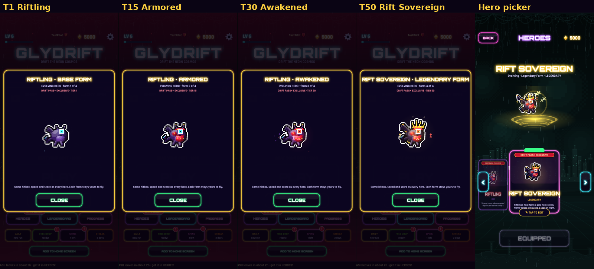
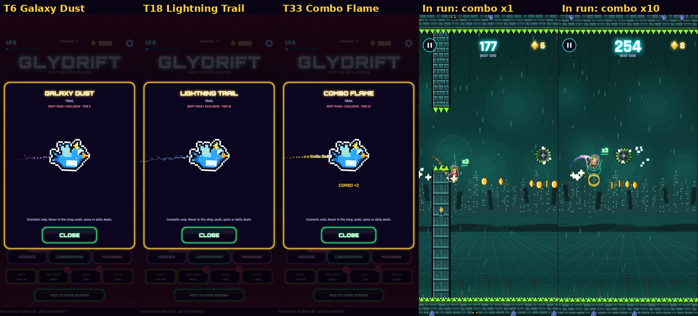
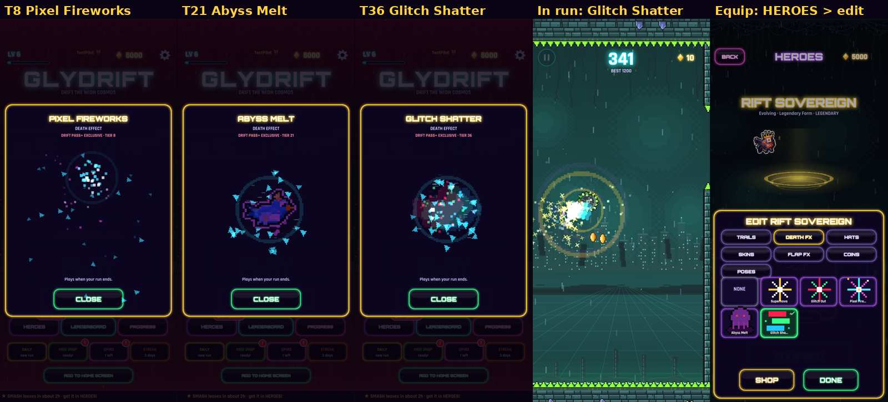
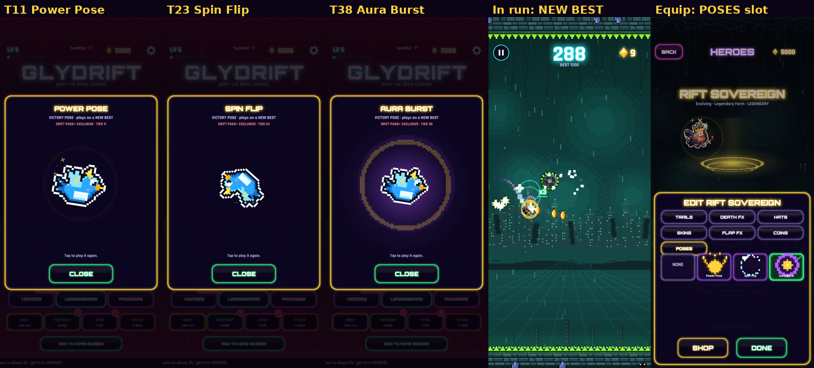
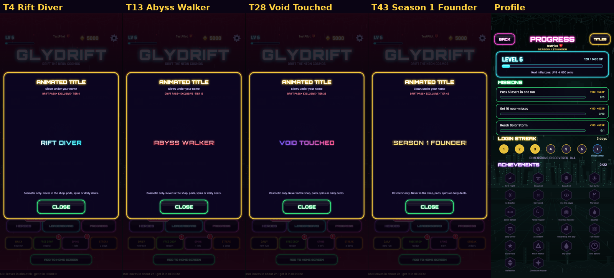
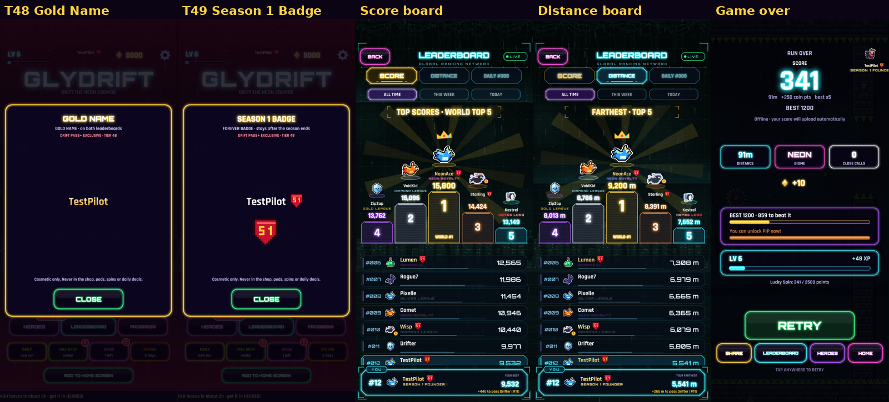
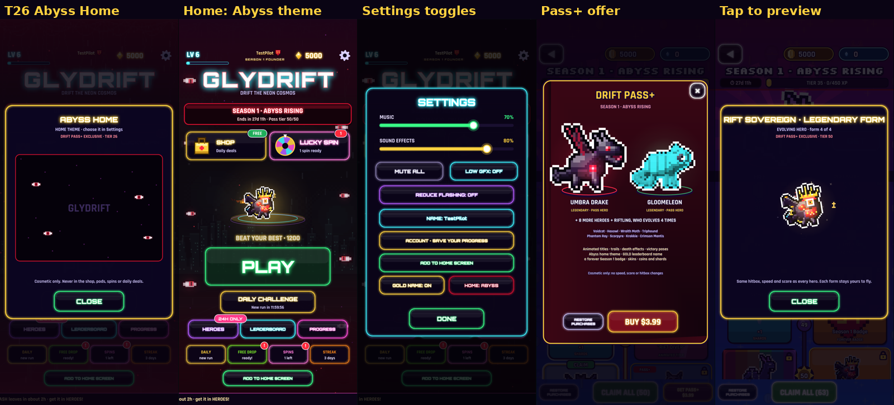
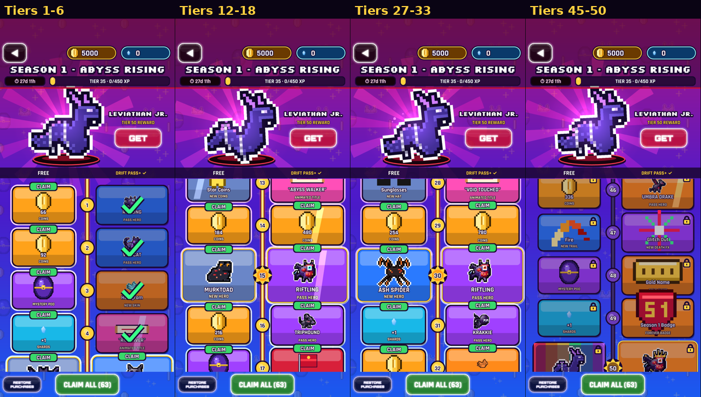

# Drift Pass+ · Season 1 "Abyss Rising" rewards

20 new rewards on the Season 1 paid track, added alongside the existing 10 pass heroes, titles, skins, trails and death effects.

## Rules (all of them)

- **Cosmetic only.** Heroes have the standard hitbox and speed and are drawn about 10% smaller. Nothing changes score, coins, physics or leaderboard rules. The hitbox/speed test now covers the four Riftling forms.
- **Exclusive to the paid track.** None of them is ever:
  - for sale;
  - in a Mystery Pod, the Lucky Spin or the daily deals;
  - listed in the shop at all (owned Pass+ items are equipped from HEROES → ✎ TAP TO EDIT).
- **Server-verified.** See [Ownership](#ownership-cant-be-faked-locally) below.
- **Reduce Flashing:** every effect has a calmer version:
  - the Lightning Trail re-forms 6×/s instead of 30×/s;
  - the gold-name shine breathes slowly and dimly;
  - poses, deaths and the Rift Sovereign's flap ring are softer;
  - Glitch Shatter slides apart instead of stepping;
  - nothing in the Abyss theme flashes.
- **Low Graphics:** fewer particles, dust, orbiting runes, eyes and motes.
- **60 fps:**
  - game logic per frame is unchanged (0.12–0.19 ms with or without them);
  - on the software renderer, draw time with the new trails is within 5–14% of a plain hero (only compare like with like);
  - orbiting runes only re-sort the display list when they pass in front of or behind the hero.

## The track (layout 2)

New rewards are **bold**. ★ = milestone.

| Tier | Reward | | Tier | Reward |
|---|---|---|---|---|
| 1 ★ | **RIFTLING · base form** (evolving hero) | | 26 | **Abyss Home** (home theme) |
| 2 ★ | Voidcat (was tier 1) | | 27 | Neon Royalty (title) |
| 3 | Hologram skin | | 28 | **"Void Touched"** (title) |
| 4 | **"Rift Diver"** (title) | | 30 ★ | **RIFTLING · Awakened** (aura form) |
| 5 ★ | Hexowl | | 31 ★ | Krakkie (was 30) |
| 6 | **Galaxy Dust** (trail) | | 32 | Inferno Core skin |
| 7 | Abyss Lord (title) | | 33 | **Combo Flame** (trail) |
| 8 | **Pixel Fireworks** (death) | | 35 ★ | Crimson Mantis |
| 10 ★ | Wraith Moth | | 36 | **Glitch Shatter** (death) |
| 11 | **Power Pose** (victory pose) | | 37 | Supernova (death) |
| 12 | Aurora (trail) | | 38 | **Aura Burst** (victory pose) |
| 13 | **"Abyss Walker"** (title) | | 40 ★ | Gloomeleon |
| 15 ★ | **RIFTLING · Armored** | | 42 | Starborn (title) |
| 16 ★ | Triphound (was 15) | | 43 | **"Season 1 Founder"** (title) |
| 17 | Crimson banner | | 45 ★ | Starlight skin |
| 18 | **Lightning Trail** | | 46 ★ | Umbra Drake (was 50) |
| 20 ★ | Phantom Ray | | 47 | Glitch Out (death) |
| 21 | **Abyss Melt** (death) | | 48 ★ | **GOLD NAME** |
| 22 | Eclipse (trail) | | 49 ★ | **SEASON 1 BADGE** (forever) |
| 23 | **Spin Flip** (victory pose) | | 50 ★ | **RIFT SOVEREIGN** (Riftling's legendary form) |
| 25 ★ | Scorpyre | | | |

- **The other tiers** (9, 14, 19, 24, 29, 34, 39, 41, 44) pay coins, shards or a Mystery Pod. No more than two of those come in a row.
- **Existing claims move with their rewards.** The layout-1 → layout-2 migration runs once per save, in `passPlus.js`.
  - Example: a player who claimed Voidcat at tier 1 sees it claimed at tier 2.
  - A coins tier that now holds a new reward opens up to be claimed.
- **Season 1's paid track is fixed in the app.** A remote season config can't move or drop these rewards.

## What each reward does

- **Riftling** (an evolving hero): each form is its own hero in the picker, labelled DRIFT PASS+ EXCLUSIVE. Players keep flying any form they've unlocked.
  - **Base form:** a one-eyed rift imp with bat wings and a crystal-tipped tail.
  - **Armored:** crimson plate with gold rivets; sparks fly off it on each flap.
  - **Awakened:** its runes glow, it has an abyss-fire aura, and two runes orbit it.
  - **Rift Sovereign** (legendary): a gold horn-crown, flame-edged wings and a cape.
    - Its own idle: the crown gems twinkle in turn, the wing tips flicker, and three runes orbit it.
    - Its own flap: the wings spread wide with blazing edges and a gold ring rolls off.
- **Titles:** "Rift Diver" shimmers, "Abyss Walker" and "Season 1 Founder" glow, and "Void Touched" shifts colour. They show under your name on the home screen (new: name and title in the top bar), the game over screen, both leaderboards and the profile.
- **Death effects** (the existing DEATH FX slot):
  - **Pixel Fireworks:** three shells pop above you.
  - **Abyss Melt:** you melt into a dripping puddle.
  - **Glitch Shatter:** RGB slices slide apart and burst.
- **Trails:**
  - **Lightning Trail:** a stepped pixel bolt with forks.
  - **Galaxy Dust:** a deep-space stream with twinkling dust.
  - **Combo Flame:** orange at ×1, then gold at ×2, green at ×3, blue at ×5 and violet at ×10. Each step blends in over about 0.3 s.
- **Victory poses** (a new POSES slot in HEROES → edit; plays on a NEW BEST mid-run):
  - **Power Pose:** a flex, a gold ring and stars.
  - **Spin Flip:** a full flip.
  - **Aura Burst:** purple and gold rings and a swelling aura.
- **Gold name:** your name in animated gold on both leaderboards, the home screen, game over and the profile. It's on as soon as you claim it; Settings → GOLD NAME: ON/OFF turns it off.
- **Season 1 badge:** a crimson "S1" crest next to your name everywhere your name shows. It stays after the season ends.
- **Abyss Home:** the menu sinks into the dark, eyes open in the shadows and blink slowly while their pupils follow your hero, and motes drift up. Pick it in Settings → HOME: SEASON / ABYSS.
- **Drift Pass screen:** tap any reward tile, claimed or not, to preview it in action:
  - heroes fly;
  - trails stream (the Combo Flame cycles through every combo colour);
  - deaths and poses loop;
  - titles, the gold name, the badge and the theme animate.

  The Pass+ offer screen also lists the new rewards.

## Ownership can't be faked locally

| Layer | What it does |
|---|---|
| Game (`data/plusGate.js`) | A Pass+ item, title or hero counts only while its season's Drift Pass+ is a **server-verified** purchase on this device. Typing an item, title, hero or `passPlus` entry into local storage shows nothing: the shop's `owns` / `loadout`, the titles, the hero picker and the selected hero all ignore it. |
| Launch check (`online/store.js` `recheck`) | Signed in: the account's verified purchases are pulled from the server, and any season the server doesn't list is dropped. Signed out: guests can't buy, so any local entitlement is dropped. Offline: nothing changes until the next online launch. |
| Leaderboard server (migration below) | Pass+ titles, Pass+ heroes and the new `flair` (gold name, S1 badge) are stripped from a score row unless that player has a verified, unrefunded purchase for the season. |

### Run this once in Supabase (you do this; nothing here touches keys)

1. Go to **supabase.com/dashboard**, open the Glydrift project, then **SQL Editor** → **New query**.
2. Paste the whole of `glydrift/supabase/migrations/20261106000001_pass_plus_s1_rewards.sql` and tap **Run**. It's safe to run more than once.

What it does:
- Adds the `flair` column to `scores`.
- Extends the existing `glydrift_check_title` trigger to cover heroes and flair.

**Order matters with one other file.** The server-checks migration `20261105000001_server_checks.sql` lives on the unmerged `protect-ip` branch. If you ever run it after this one, run this one again afterwards. Both orders were tested on Postgres 16; with this file last, a tampered row loses its Pass+ title, hero and flair.

Until it runs:
- the game still works: it detects the missing column and leaves flair off rows;
- the gold name and badge show only on your own screens;
- the hero check isn't on the server yet.

## Test flags (test builds only; compiled out of release builds)

- `?pplus`: own Season 1's Drift Pass+ with every paid-track reward claimed.
- `?ppequip=trail_pp_lightning,p_s1founder,riftsovereign`: equip items, titles or a hero.
- `?ppreview=<id>`: open the tap-to-preview card for one reward on the home screen. Ids:
  - Riftling forms: `riftling`, `riftling_armor`, `riftling_aura`, `riftsovereign`
  - trails: `trail_pp_galaxydust`, `trail_pp_lightning`, `trail_pp_comboflame`
  - death effects: `death_pp_fireworks`, `death_pp_melt`, `death_pp_shatter`
  - victory poses: `pose_pp_power`, `pose_pp_spinflip`, `pose_pp_aura`
  - titles: `p_riftdiver`, `p_abysswalker`, `p_voidtouched`, `p_s1founder`
  - the rest: `theme_pp_abyss`, `name_pp_gold`, `badge_pp_s1`

## Screenshots

