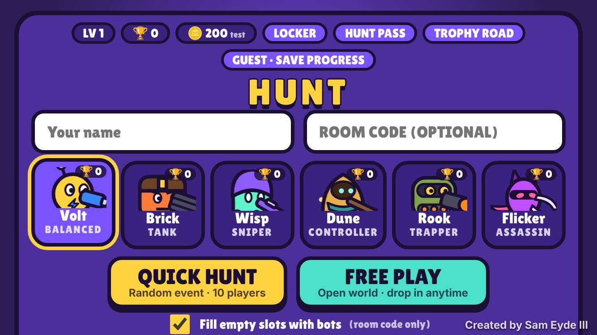
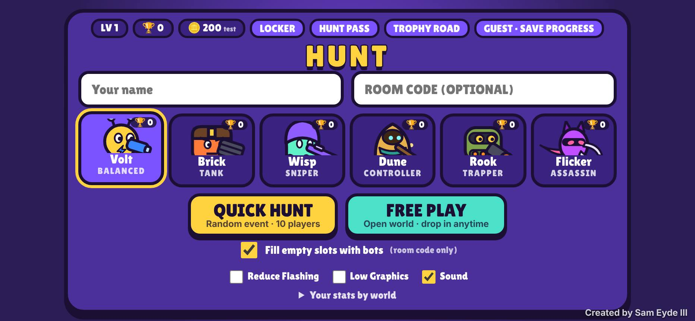
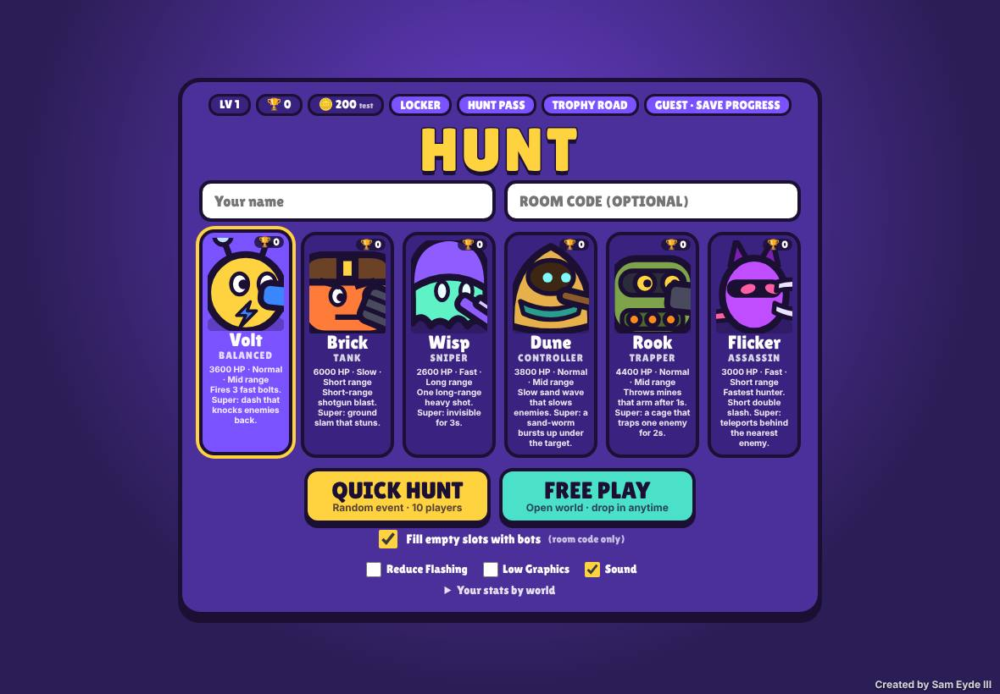
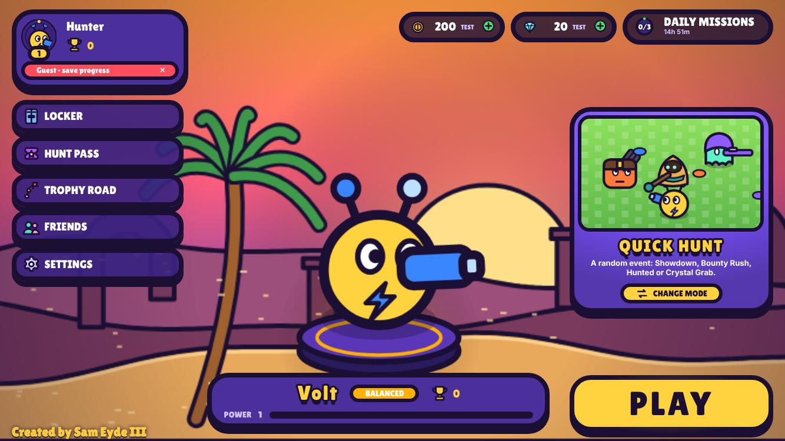
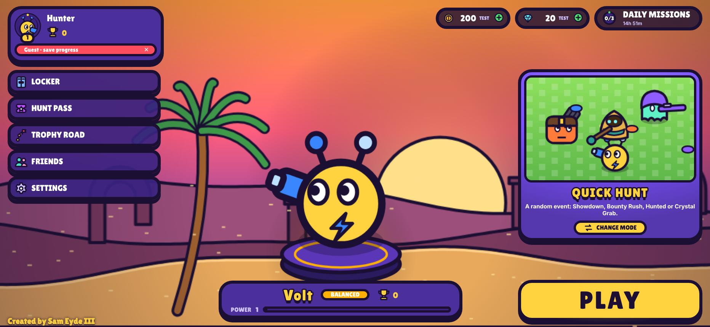
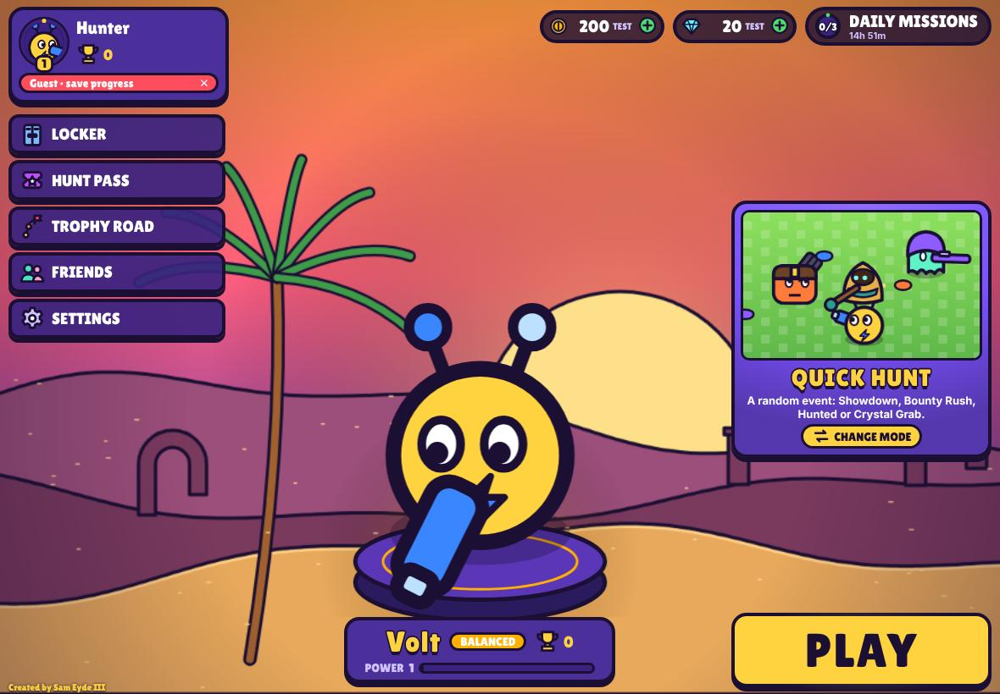

# Morning report: overnight queue

Everything below is merged into the **`nightly`** branch. Each task also has its own branch.
Nothing went to a live site.

## TL;DR

| # | Task | Status | Branch |
|---|------|--------|--------|
| 0 | Finish Desert Mirage (+ e2e suite, settings, credit) | ✅ done | `world/desert-mirage` |
| 1 | Three new brawlers + balance | ✅ done | `task/new-brawlers` |
| 2 | Squad Hunt 3v3 | ✅ done | `task/squad-hunt` |
| 3 | Accounts + progression (D1) | ✅ done | `task/accounts` |
| 4 | Skins, effects, titles, Hunt Pass (test currency) | ✅ done | `task/cosmetics` |
| 5 | Smarter bots | ✅ done | `task/smarter-bots` |
| 6 | Game feel polish | ✅ done | `task/game-feel` |
| + | Map art system (walls, cover, materials) | ✅ done | `map/art-system` |
| + | Performance pass + this report | ✅ done | `task/perf-report` |
| 7 | **Preview deploy** | ⚠️ **blocked**: see below | n/a |

Test suite: **29 Playwright tests pass on Chromium**. They include the headless simulation suites: sim, mirage, brawlers + balance, squad, progression, cosmetics, bots and map art.
- **Firefox and WebKit could not run.** Only Chromium is installed in this environment, and its rules forbid `playwright install`. `playwright.config.js` defines all three browser projects and runs any browser that is installed. **Please run `npm run e2e` on a machine with all three before trusting cross-browser behaviour.**

## What got finished

**Desert Mirage.**
- An e2e lane with a smoke test, Quick Hunt (two clients, one eliminates the other), Free Play handoff (no snap), and Mirage display-order and old-save tests.
- Settings for **Reduce Flashing** (no shake or strobe, steady glows, CSS animations off; it also respects the OS reduced-motion preference) and **Low Graphics** (1× resolution, no shadows, ambient particles, slime animation or ground clutter).
- The **"Created by Sam Eyde III"** credit didn't exist in Hunt, so I added it to the lobby and in-game. A test guards it.

**Task 1: brawlers.**
- **Dune:** a slow sand wave that slows enemies to 60% speed for 1.5s. Super: a sand-worm bursts up under the target after a 0.7s ripple warning.
- **Rook:** thrown mines that arm after 1s, at most 3 out. Armed mines are hidden from enemies until they're within 90 px, which is what makes trapping work. Super: a cage that traps one enemy for 2s.
- **Flicker:** 3000 HP, the fastest brawler (310 speed), a short double slash. Super: teleports behind the nearest visible enemy.

**Task 2: Squad Hunt.**
- Two teams of 3. Kills add `1 + victim bounty` to the team pot, and the stolen bounty leaves the victim's pot.
- The highest pot at 3:00 wins.
- Blue/red rings and health bars, teammates always visible and on the radar, no friendly fire.
- Bots fill the teams. It's in the Quick Hunt pool.

**Task 3: accounts.**
- Every player gets a server-side D1 account; guests just have no credentials. "Save progress" upgrades the same row, so nothing is lost.
- Passwords use PBKDF2-SHA256 (100k iterations, per-user salt). Session tokens are stored only as SHA-256 hashes.
- **Match results are applied on the server** by the match Durable Object: per-brawler trophies (+8 / +4 / −2 / never below 0) and XP and levels.
- Trophy road with a free reward every 100 trophies; claims are checked on the server.
- Cloud sync: progress lives in D1 and refreshes when the app comes back to the foreground. A test covers "log in on a second device".

**Task 4: cosmetics.**
- 12 skins (2 per brawler), 5 kill effects, and 10 titles shown under the player's name.
- A Locker screen, and a 30-tier Hunt Pass with free and premium tracks. Premium costs 950 **Hunt Coins (test)**; the UI says "test currency only, no real money" everywhere.
- Equipped cosmetics are read from your account on the server, so they can't be spoofed through the URL.
- A test proves identical hitboxes, stats and movement with and without skins.

**Task 5: bots.**
- **Fair vision.** Bots only use what a human sees: `canSee` (bushes, cloak, blackout fog) plus public radar pings, remembered as last-known positions. I removed an older leak where mode goals read hidden players' live positions.
- They take cover while reloading, hide in bushes when low, chase high bounties, dodge telegraphed lava, wildfire and worm warnings, avoid visible mines and spiked borders, and use Supers situationally.
- **Easy / normal / hard** levels, chosen from the human players' trophies: under 150 is easy, under 500 normal, otherwise hard. Hard bots beat easy ones 45 of 60 in mirror duels.

**Task 6: game feel.**
- **Original synthesized sound** (Web Audio, no sample files): six weapon voices, hits, hurt, Supers, slam, mine boom, worm, blink, eliminations, a bounty-steal coin arpeggio, pickups, world-event warnings, and victory/defeat jingles.
- Bullet trails, popping damage numbers, a "KO!" pop plus "+★N BOUNTY STOLEN".
- A victory pose (or a sulk) on the end screen, and a **Top Bounty Hunter** MVP banner.
- Shake and flashes are off under Reduce Flashing (tested).

**Map art system.**
- Maps are now built from cover **pieces** (1×1, 2×1, 3×1, 2×2, L3, L4). The drawn cells are exactly the collision cells; a test checks there are no invisible edges.
- One themes file, `public/art/themes.js`: Meadow and Hub use stone (Hub in warm gold and ivory, no spikes), City metal (neon cyan spikes), Wildwood wood (deep red spikes, plus a temple-roof strip along the north edge), Dust Flats and **Desert Mirage** sandstone (deep teal and purple spikes; Mirage adds a shimmer overlay), Frozen Lake ice (white-blue spikes).
- Each material has three looks, painted once into offscreen canvases at 16 art-pixels per cell and drawn nearest-neighbour. The cache holds at most 4 worlds (LRU) and **rebuilds after `contextlost`/`contextrestored`** (tested).
- **Spiked borders** around every map and between Free Play zones (with gaps to walk through) deal 5% max HP with a 1s cooldown. About 1 in 6 cover pieces has a decorative spiked, slimy side.
- Slime drips animate slowly: a steady glow under Reduce Flashing, off in Low Graphics.
- Arenas: 4-fold mirrored, with open middle lanes, **28–38 cover pieces**, 8 bush patches, and **cover near every spawn** (checked on 1,200 generated maps).
- `?mapview=1` (add `&world=<key>` or `&free=1`) shows the whole map with collision boxes and each spawn's cover radius.

**Performance.**
- Fixed the lobby portraits redrawing during matches, which was the biggest waste the profiler found.
- Static ground is now cached in 8×8-tile chunks.
- Added **adaptive resolution**: render resolution steps from 2× down to 1× when frames run long and back up when there's headroom.

## What got skipped or blocked, and why

1. **Preview deploy: blocked.** The Cloudflare credential connected to this session can create and migrate D1 databases, but gets **HTTP 403 on every Worker script endpoint**, so `wrangler deploy` fails at its first request. What's ready:
   - A separate preview Worker config, `wrangler.preview.jsonc` (Worker `hunt-preview`, so it can never collide with a live `hunt` Worker).
   - A real D1 database, `hunt-preview-db` (`cd603982-d837-4ab0-a694-8c027afd9904`), already migrated.
   - **To deploy:** `cd hunt && npx wrangler deploy -c wrangler.preview.jsonc` with a token that has *Workers Scripts: Edit*. It will print `https://hunt-preview.<your-subdomain>.workers.dev`.
2. **Firefox and WebKit:** not installed here (see the top of this report).
3. **"60 fps on iPhone SE": not verifiable from this machine.** There's no GPU and no device, so all numbers below come from software rendering. Please check on a real SE.
4. **Glydrift reference files** (`glydrift/src/pixel/biomeArt.js`, `themes.js`) are not in this repository or anywhere this session can reach. I built the art system from your written spec instead.
5. **Free Play zones are not literally hand-placed.** They're laid out by a fixed-seed generator, identical on every server and client, with designed rules: border gaps, a hub ring and no cover near the hub. Hand-authoring four 40×40 zones is better done with you in the loop.
6. **64 px grid:** the arena stays 2000×2000 as originally specified, so collision stays on the 50-unit grid. The art is authored at 64 px per cell (16 art-pixels at 4×) and drawn into each 50-unit cell.

## Preview URL

None yet: see blocked item 1. It's one command once a token with Workers permission is used.

## Bot balance numbers

Method: 1v1 bot duels between different brawlers, cycling every ordered pair, on random arenas and spawns, with normal bots (`test/balance.js`). Damage was auto-tuned toward 50% (`test/tune.js`) and re-tuned after the new bots and again after the new maps.

**Final, 3,000 duels (about 1,000 per brawler):**

| Brawler | Win rate |
|---|---|
| Volt | 51.7% |
| Brick | 46.6% |
| Wisp | 50.3% |
| Dune | 50.4% |
| Rook | 50.9% |
| Flicker | 50.1% |

All six are inside 45–55%. The `brawlers.test.js` gate (1,800 duels) asserts 45–55% for every brawler.

**About "300 bot matches".** Three separate 300-duel runs (about 100 games per brawler) landed between **39% and 60%**. With only about 100 games each, sampling noise alone is ±5 points, so at that sample size even perfectly balanced brawlers don't reliably stay inside 45–55%. I used the larger samples to decide balance.

**Classic brawlers were changed to reach this balance. Please review:**

| | Before | After |
|---|---|---|
| Volt bolt | 420 | 330 |
| Volt dash | 700 | 550 |
| Brick pellet | 330 | 280 |
| Brick slam | 900 | 770 |
| Wisp shot | 1450 | 1620 |

New brawlers: Dune wave 1010 / worm 1880; Rook mine 1720 / cage 520; Flicker slash 490 ×2.

**Caveat:** this measures bot-vs-bot duels. Human players and 10-player brawls will play out differently.

## Performance (software rendering, no GPU)

Emulated an iPhone SE in landscape (667×375 at 2×) with Chromium's CPU throttled 4×, in a 10-player Bounty Rush match:

| | Before the perf pass | After |
|---|---|---|
| Desert Mirage | 13 fps (79 ms) | **47 fps** (21 ms, p95 33 ms) |
| Wildwood | 20 fps | **55 fps** |
| Low Graphics | 27 fps | **51 fps** |

Adaptive resolution had dropped to 1× in all three runs. A real iPhone draws canvas on the GPU, so it should do better than this, but it still needs checking on a device.

## Screenshots (`hunt/docs/morning/`)

iPhone 13 (landscape) and iPad Pro 11 for each feature:
- Lobby with 6 brawlers and the profile bar: [iPhone](docs/morning/iphone-01-lobby.jpg) · [iPad](docs/morning/ipad-01-lobby.jpg)
- Account / save progress: [iPhone](docs/morning/iphone-02-account.jpg) · [iPad](docs/morning/ipad-02-account.jpg)
- Trophy road: [iPhone](docs/morning/iphone-03-trophy-road.jpg) · [iPad](docs/morning/ipad-03-trophy-road.jpg)
- Locker: [iPhone](docs/morning/iphone-04-locker.jpg) · [iPad](docs/morning/ipad-04-locker.jpg)
- Hunt Pass: [iPhone](docs/morning/iphone-05-hunt-pass.jpg) · [iPad](docs/morning/ipad-05-hunt-pass.jpg)
- New brawlers:
  - Flicker on Mirage: [iPhone](docs/morning/iphone-06-brawler-flicker-mirage.jpg) · [iPad](docs/morning/ipad-06-brawler-flicker-mirage.jpg)
  - Rook on City: [iPhone](docs/morning/iphone-06-brawler-rook-city.jpg) · [iPad](docs/morning/ipad-06-brawler-rook-city.jpg)
  - Dune on Wildwood, with Lava Flow: [iPhone](docs/morning/iphone-06-brawler-dune-forest.jpg) · [iPad](docs/morning/ipad-06-brawler-dune-forest.jpg)
- Squad Hunt: [iPhone](docs/morning/iphone-07-squad-hunt.jpg) · [iPad](docs/morning/ipad-07-squad-hunt.jpg)
- End screen (victory pose, MVP banner, trophy and XP gain): [iPhone](docs/morning/iphone-08-end-screen.jpg) · [iPad](docs/morning/ipad-08-end-screen.jpg)
- Wall art per world:
  - Meadow: [iPhone](docs/morning/iphone-09-art-meadow.jpg) · [iPad](docs/morning/ipad-09-art-meadow.jpg)
  - City: [iPhone](docs/morning/iphone-09-art-city.jpg) · [iPad](docs/morning/ipad-09-art-city.jpg)
  - Wildwood: [iPhone](docs/morning/iphone-09-art-forest.jpg) · [iPad](docs/morning/ipad-09-art-forest.jpg)
  - Dust Flats: [iPhone](docs/morning/iphone-09-art-desert.jpg) · [iPad](docs/morning/ipad-09-art-desert.jpg)
  - Desert Mirage: [iPhone](docs/morning/iphone-09-art-mirage.jpg) · [iPad](docs/morning/ipad-09-art-mirage.jpg)
  - Frozen Lake: [iPhone](docs/morning/iphone-09-art-frozen.jpg) · [iPad](docs/morning/ipad-09-art-frozen.jpg)
- Free Play hub: [iPhone](docs/morning/iphone-10-freeplay-hub.jpg) · [iPad](docs/morning/ipad-10-freeplay-hub.jpg)
- `?mapview=1` for each world: [Meadow](docs/morning/mapview-meadow.jpg) · [City](docs/morning/mapview-city.jpg) · [Wildwood](docs/morning/mapview-forest.jpg) · [Dust Flats](docs/morning/mapview-desert.jpg) · [Desert Mirage](docs/morning/mapview-mirage.jpg) · [Frozen Lake](docs/morning/mapview-frozen.jpg) · [Free Play world](docs/morning/mapview-freeplay-world.jpg)

The screenshots were taken before the final perf pass, which didn't change any visuals.

## Top 5 things to fix or decide next

1. **Deploy the preview and play it on a real iPhone SE and iPad.** Check fps, touch feel and the adaptive-resolution steps. Nothing about real-device performance or touch is proven yet.
2. **Decide on the classic-brawler damage changes.** They were made to balance bot duels, not human play. Also decide whether you want trophy matchmaking (right now trophies only set bot difficulty), and whether rebalancing should eventually come from real match data.
3. **Harden accounts before any public link.**
   - Rate-limit or add bot protection to `/api/register`, `/api/login` and `/api/guest`.
   - Add a cleanup policy for abandoned guest rows; every new browser creates one.
   - Account recovery: there's no email, so a forgotten password means a lost account.
   - Before real Apple payments: move coin grants to server-validated receipts.
4. **Free Play trust and persistence.**
   - Watching a neighbouring zone uses a client-reported position, so a modified client could see players hiding in bushes there.
   - Zones reset when empty.
   - Decide whether the zone layouts should be hand-authored.
5. **CI coverage.** Run the e2e suite on Firefox and WebKit plus a device lab. The free-play border-crossing test needed a sidestep fix tonight because of the new hub pillars; it passed 15/15 afterwards, but keep an eye on it.

## How to run everything

```bash
cd hunt
npm install
npm test                 # headless sims: modes, worlds, brawlers + balance gate, squad, progression, cosmetics, bots
npm run e2e              # Playwright suite (starts wrangler dev on :8788 itself)
node test/balance.js 3000 99    # balance table
node test/tune.js 6             # auto-tune damage toward 50% (prints values, doesn't write them)
npm run dev              # play locally / on your phone (see README)
```

Debug flags:
- `?world=<key>&mode=<mode>&ev=<event>` puts you straight into a match with bots.
- `?mapview=1` shows the whole map with collision boxes.
- `?free=1` goes straight to Free Play.

---

# UI overhaul (branch `ui/overhaul`)

Every screen outside a match was rebuilt on one design system, in the same bold cartoon style. All art is drawn in code or SVG, the music is synthesized live, and there are no image or audio files.

## Lobby: before / after

| | iPhone SE | iPhone Pro Max | iPad |
|---|---|---|---|
| **Before** |  |  |  |
| **After** |  |  |  |

## What's new

**Design system**
- `public/ui/tokens.css` is the single place for colours, the one outline thickness, the one shadow, 3 button sizes (`btn-sm`/`md`/`lg`), 2 card styles (`card-a` solid, `card-b` art card with a role-coloured backdrop), motion timing and safe-area padding.
- Sizes scale from the screen's short side, so the same layout fits an iPhone SE and an iPad.
- `public/ui/icons.js` holds one SVG icon style: chunky fill with the shared ink outline.

**Lobby**
- **Living background.** Parallax layers of the featured world: Desert Mirage has dunes, ruins, a low sun with heat shimmer, a swaying palm and drifting sand. It rotates to a different world each day, and `?featured=<world>` forces one.
- **Centre stage.** Your brawler stands on a glowing pedestal at about 40% of screen height, and idles with a bob, blink and weapon twirl. Tapping it plays a taunt; tapping again opens brawler select. The name plate shows name, role, trophies and a power-level bar.
- **Left rail.**
  - Profile card: avatar, name, level ring with an XP arc, and trophies.
  - The guest banner is now a small dismissible "Guest · save progress" chip on the card.
  - Icon buttons for Locker, Hunt Pass, Trophy Road, Friends and Settings, each with a red dot when something is claimable or new.
- **Top bar.** Test coins and test gems, each with a "+" chip; the "+" explains test currency, since there are no payments. A daily-missions chip shows a progress ring and the time until reset.
- **Mode card.** An animated preview of the current mode, a ribbon, and a tap to open the mode picker.
- **PLAY button.**
  - Bottom-right, chunky yellow with a pulsing glow.
  - Press-squash, release-bounce and a play sound.
  - Tested to stay fully on screen on all three sizes, and never to overlap the mode card.
- **Moved off the main screen.** Your name lives in Profile and the room code in a Play with Friends popup. "Created by Sam Eyde III" stays visible in gold, small, bottom-left.

**Brawler select**
- Large role-coloured cards, with the brawler drawn bursting out of the top of the frame.
- Role filter chips.
- Tapping a card flips open a detail panel:
  - an animated portrait;
  - Health / Damage / Speed / Range bars;
  - looping demo animations for the Attack and the Super;
  - the skin picker.

**Mode picker**
- Quick Hunt, Squad Hunt (NEW), Free Play and Showdown (EVENT), each with animated art, a one-line description and the player count.
- The 9 world events are previewed as icons along the bottom.
- Quick play can now queue for one specific mode: the matchmaker keeps a separate filling match per mode.

**Locker**
- Skins on rotating pedestals, plus Kill Effects and Titles tabs.
- A big live preview of the equipped look, with a kill-effect preview button.

**Hunt Pass**
- A horizontally scrolling track: premium row on top, free row below.
- A progress bar that fills with a shine.
- Claiming pops the reward and flies coins into the top-bar counter, with light rays.

**Trophy Road**
- A winding vertical path with milestones and rewards on alternating sides.
- It auto-scrolls to your position, marked with a glowing marker.

**Match flow**
- **Matchmaking:** your brawler runs in place on a spinning radar, with a players-found counter ("3/10 hunters found · starts in 6"), rotating tips and a cancel button.
- **Match intro:** a 2-second VS splash with "ENTERING DESERT MIRAGE" and the mode name.
- **Results:**
  - the rank slams in, then your brawler's victory pose (or a sulk);
  - trophies count up and the XP bar fills;
  - bounty earned and KOs, plus the Top Bounty Hunter MVP banner;
  - Play Again and Lobby buttons.

**Motion and sound**
- Every button squashes on press, bounces on release and plays a click.
- Screens slide and scale in over about 260 ms with ease-out and fade out; popups pop in. There are no hard cuts.
- Rewards fire light rays and confetti; under Reduce Flashing that becomes a soft fade only.
- **Original lobby music:** an upbeat 4-bar loop at 116 BPM (bass bounce, plucky lead, pad, drums) synthesized live. It ducks under popups.
- Settings has separate Music and SFX sliders.

**Daily missions and gems (test currency)**
- 3 missions a day, the same for every player, resetting at 00:00 UTC.
- Progress is tracked on the server when a match is recorded; rewards are test coins or gems.

## Every screen on 3 devices

| Screen | | | |
|---|---|---|---|
| Lobby | [iPhone SE](docs/ui/ui-lobby-se.jpg) | [iPhone Pro Max](docs/ui/ui-lobby-promax.jpg) | [iPad](docs/ui/ui-lobby-ipad.jpg) |
| Brawler select | [iPhone SE](docs/ui/ui-brawlers-se.jpg) | [iPhone Pro Max](docs/ui/ui-brawlers-promax.jpg) | [iPad](docs/ui/ui-brawlers-ipad.jpg) |
| Brawler detail (flip panel) | [iPhone SE](docs/ui/ui-detail-se.jpg) | [iPhone Pro Max](docs/ui/ui-detail-promax.jpg) | [iPad](docs/ui/ui-detail-ipad.jpg) |
| Mode picker | [iPhone SE](docs/ui/ui-modes-se.jpg) | [iPhone Pro Max](docs/ui/ui-modes-promax.jpg) | [iPad](docs/ui/ui-modes-ipad.jpg) |
| Locker | [iPhone SE](docs/ui/ui-locker-se.jpg) | [iPhone Pro Max](docs/ui/ui-locker-promax.jpg) | [iPad](docs/ui/ui-locker-ipad.jpg) |
| Hunt Pass | [iPhone SE](docs/ui/ui-pass-se.jpg) | [iPhone Pro Max](docs/ui/ui-pass-promax.jpg) | [iPad](docs/ui/ui-pass-ipad.jpg) |
| Trophy Road | [iPhone SE](docs/ui/ui-road-se.jpg) | [iPhone Pro Max](docs/ui/ui-road-promax.jpg) | [iPad](docs/ui/ui-road-ipad.jpg) |
| Matchmaking | [iPhone SE](docs/ui/ui-matchmaking-se.jpg) | [iPhone Pro Max](docs/ui/ui-matchmaking-promax.jpg) | [iPad](docs/ui/ui-matchmaking-ipad.jpg) |
| Match intro (VS) | [iPhone SE](docs/ui/ui-intro-se.jpg) | [iPhone Pro Max](docs/ui/ui-intro-promax.jpg) | [iPad](docs/ui/ui-intro-ipad.jpg) |
| Results | [iPhone SE](docs/ui/ui-results-se.jpg) | [iPhone Pro Max](docs/ui/ui-results-promax.jpg) | [iPad](docs/ui/ui-results-ipad.jpg) |
| Profile | [iPhone SE](docs/ui/ui-profile-se.jpg) | [iPhone Pro Max](docs/ui/ui-profile-promax.jpg) | [iPad](docs/ui/ui-profile-ipad.jpg) |
| Settings | [iPhone SE](docs/ui/ui-settings-se.jpg) | [iPhone Pro Max](docs/ui/ui-settings-promax.jpg) | [iPad](docs/ui/ui-settings-ipad.jpg) |
| Play with Friends | [iPhone SE](docs/ui/ui-friends-se.jpg) | [iPhone Pro Max](docs/ui/ui-friends-promax.jpg) | [iPad](docs/ui/ui-friends-ipad.jpg) |
| Daily missions | [iPhone SE](docs/ui/ui-missions-se.jpg) | [iPhone Pro Max](docs/ui/ui-missions-promax.jpg) | [iPad](docs/ui/ui-missions-ipad.jpg) |

## Checks

- **Tests:** 35 Playwright tests pass on Chromium. New in `tests/e2e/ui.spec.js`:
  - For each of the 3 sizes, PLAY, the profile card, mode card, name plate, missions chip, Settings button and credit are all fully inside the screen, and PLAY never overlaps the mode card.
  - Every screen opens and closes through its transition.
  - The mode picker changes the mode card.
  - Missions show 3 entries.
  - The full PLAY → matchmaking radar → VS intro → match → results → lobby flow.
  - Music starts after a tap and ducks under popups.
  - Low Graphics freezes the background.
- **Performance:** emulated iPhone SE (667×375 at 2×) with Chromium's CPU throttled 4× and **software rendering** (no GPU here). This is pessimistic; a real phone uses its GPU.

  | Lobby | Before tuning | After |
  |---|---|---|
  | Full graphics | 13 fps | **47 fps** |
  | Low Graphics | n/a | **60 fps** |

  Tuning: the static sky, sun and vignette are cached; the PLAY glow animates only opacity; and adaptive resolution steps the soft backdrop and stage down when frames run long. **Needs confirming on a real iPhone SE.**
- **Low Graphics** turns off the moving background and particles, drawing a single static frame. **Reduce Flashing** turns off strobing, pulsing and confetti, leaving steady glows and soft fades.

## Notes and next decisions

- **Friends list:** the Friends button opens Play with Friends (room code, a new-code generator, share/copy). A real friends list needs a social backend; it's marked "coming soon".
- **The "+" chips** explain test currency rather than selling anything. When Apple payments are added, this is where a store would go.
- **Power level** is cosmetic for now: it's derived from trophies (one level per 50, max 11). Decide whether you want a real upgrade system.
- **Brawler locks:** the lock state is designed and drawn, but every brawler is unlocked today. Decide on unlock rules, such as trophy-road unlocks.
